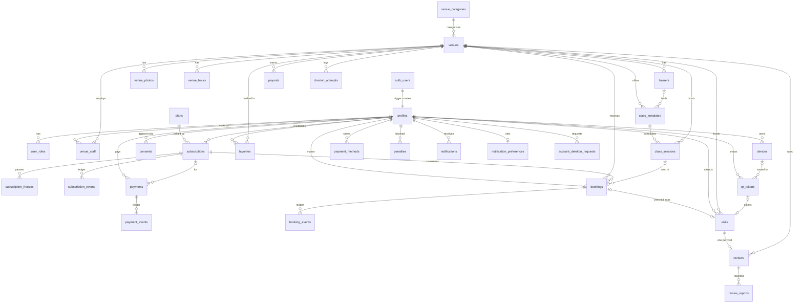

# 1Heal — architecture: database and app ↔ backend (M2)

Schema `public` on Supabase Postgres 17 (and the embedded PostgreSQL used by `npm run db:test`).
Migrations: `supabase/migrations/0001…0010` (M2 schema; 0010 publishes `feature_flags` to Realtime),
`0090+` for the SMS hook. Tests: `supabase/tests/**/*.test.ts`. Runbook: `docs/RUNBOOK.md` ("Database").
How the app reaches all of this: section 6.

## 1. ER diagram



Standalone: `sms_send_log` (rate limits, written by the SMS hook), `webhook_inbox` (idempotent
provider callbacks), `feature_flags`, `audit_log` (written by triggers).

## 2. Conventions

- `id uuid primary key default gen_random_uuid()`; `created_at`/`updated_at timestamptz`; the
  shared trigger `set_updated_at` is attached by `public.ensure_updated_at_triggers()` at the end
  of each migration to every table that has `updated_at`.
- Ledgers (`subscription_events`, `payment_events`, `booking_events`, `audit_log`) are append-only
  and carry `seq bigint identity` for a stable order inside one transaction.
- Money is integer UZS (`*_uzs`). Phones are E.164 text with a check (`+998XXXXXXXXX`).
- i18n text is `jsonb {"ru","uz","en"}` checked by `public.jsonb_i18n_valid()` (`ru` required,
  non-empty); optional descriptions/bios only require an object.
- Enums are Postgres enum types (`user_role`, `app_locale`, `app_theme`, `gender`,
  `venue_staff_role`, `consent_kind`, `device_platform`, `venue_status`, `session_status`,
  `class_level`, `plan_code`, `subscription_status`, `payment_provider`, `payment_status`,
  `payment_event_source`, `payout_status`, `booking_status`, `visit_method`, `penalty_kind`,
  `review_status`), created in idempotent `do` blocks.
- Geo: `venues.lat/lng double precision` + GiST index on `ll_to_earth(lat, lng)` (cube +
  earthdistance, available on Supabase and the embedded cluster). No PostGIS.
- Extensions are created in schema `extensions` when it exists (Supabase), else `public`;
  `pg_cron` only where available. No cron jobs are scheduled yet (M5 adds them).
- User references point at `public.profiles(id)` (cascade from `auth.users`), so generated types
  carry the relationships and joins work through PostgREST.
- Roles come from the JWT claim `app_metadata.roles`, written by
  `public.custom_access_token_hook` from `user_roles` (ADR-013). A role change takes effect on the
  next token refresh (≤ `jwt_expiry`, 1 h); revoking an admin immediately requires a sign-out
  (session deletion) in addition to deleting the row.
- Helper functions used in policies: `current_user_id()`, `app_role()`, `has_role(text)`,
  `is_admin()`, `is_venue_staff(uuid)`, `is_venue_owner(uuid)`, `venue_is_active(uuid)`; the
  table-reading ones are `security definer` with a pinned `search_path` to avoid RLS recursion.
- `venue_hours.weekday`: 0 = Sunday … 6 = Saturday (`extract(dow)`); `closes <= opens` means an
  overnight slot that ends on the next day. `rpc_venue_is_open(venue, at)` evaluates in the venue's
  `tz`.

## 3. Triggers and server rules present in M2

| Trigger                                                                                                                | Rule                                                                                                                                                    |
| ---------------------------------------------------------------------------------------------------------------------- | ------------------------------------------------------------------------------------------------------------------------------------------------------- |
| `auth.users` insert → `handle_new_auth_user`                                                                           | creates `profiles` (`phone_e164 = '+' ‖ phone`, `full_name` from metadata) and `user_roles(member)`                                                     |
| `auth.users` update of phone                                                                                           | keeps `profiles.phone_e164` in sync                                                                                                                     |
| `payments` before update of status                                                                                     | `enforce_payment_transition`: created→pending/failed, pending→paid/failed, paid→refunded/disputed, disputed→refunded/paid; else `P0001`; sets `paid_at` |
| `payments` after insert/update of status                                                                               | `log_payment_event` → `payment_events` (source from `oneheal.payment_event_source` setting, admin JWT, no JWT = system, else client)                    |
| `subscriptions` after insert/update of status                                                                          | `subscription_events` (`created`, `status_changed`)                                                                                                     |
| `bookings` after insert/update of status                                                                               | `booking_events` (`created`, `status_changed`)                                                                                                          |
| `reviews` after insert/update/delete                                                                                   | `venues.rating_avg/rating_count` over published reviews                                                                                                 |
| `reviews` before update                                                                                                | members may change only `rating` and `text` (else `42501`); RLS adds the 24 h window                                                                    |
| `audit` on venues, venue_staff, user_roles, plans, subscriptions, payments, payouts, penalties, feature_flags, reviews | `write_audit` → `audit_log` (actor from the JWT, before/after rows)                                                                                     |

Constraints worth knowing: one non-terminal subscription per user (partial unique on `user_id`
where status not in cancelled/expired); one live booking per user and session (partial unique);
`visits.booking_id` and `visits.qr_jti` unique; `reviews.visit_id` unique; freezes ≤ 30 days;
`webhook_inbox (provider, external_id)` unique; `payments.idempotency_key` and
`(provider, provider_txn_id)` unique; one open `account_deletion_requests` per user.

## 4. RLS matrix

Every table has RLS enabled (asserted automatically by `rls-coverage.test.ts`, which also pins the
list of tables anon may read). `anon`/`authenticated` start with no table grants; `service_role`
has all grants and bypasses RLS. "—" = no grant. "owner" = `user_id = auth.uid()`.
"rpc" = writes arrive only through security definer `rpc_*` functions or Edge Functions (M5–M7).

| Table                                                    | anon                | authenticated read                                                         | authenticated write                                                         |
| -------------------------------------------------------- | ------------------- | -------------------------------------------------------------------------- | --------------------------------------------------------------------------- |
| profiles                                                 | —                   | own row; admin all                                                         | update own row; admin all                                                   |
| user_roles                                               | —                   | own rows; admin all; `supabase_auth_admin` all (hook)                      | admin                                                                       |
| venue_staff                                              | —                   | own rows; venue owner their venue; admin                                   | venue owner (their venue); admin                                            |
| devices                                                  | —                   | owner                                                                      | owner (insert/update/delete)                                                |
| consents                                                 | —                   | owner; admin                                                               | owner insert (append-only)                                                  |
| sms_send_log                                             | —                   | admin                                                                      | — (service role)                                                            |
| venue_categories                                         | read                | read                                                                       | admin                                                                       |
| venues                                                   | `status = active`   | active, or own venue (staff), or admin                                     | insert/delete admin; update venue owner or admin                            |
| venue_photos, venue_hours, class_sessions                | of active venues    | of active venues; staff their venue; admin                                 | venue staff; admin                                                          |
| trainers, class_templates                                | active of active v. | same + staff/admin                                                         | venue staff; admin                                                          |
| favorites                                                | —                   | owner                                                                      | owner insert/delete                                                         |
| plans                                                    | `active`            | active; admin all                                                          | admin                                                                       |
| subscriptions, subscription_freezes, subscription_events | —                   | owner (via subscription); admin                                            | rpc                                                                         |
| payments, payment_events                                 | —                   | owner (via payment); admin                                                 | rpc                                                                         |
| payment_methods                                          | —                   | owner, columns without `provider_token` (select explicit columns, not `*`) | owner update `is_default`, delete; insert via rpc                           |
| webhook_inbox                                            | —                   | admin                                                                      | — (service role)                                                            |
| payouts                                                  | —                   | venue owner; admin                                                         | — (service role)                                                            |
| bookings, booking_events                                 | —                   | owner; venue staff (their venue); admin                                    | rpc                                                                         |
| visits, checkin_attempts                                 | —                   | owner; venue staff (their venue); admin                                    | rpc                                                                         |
| qr_tokens, penalties                                     | —                   | owner; admin                                                               | rpc                                                                         |
| reviews                                                  | `published`         | published, own (any status), admin                                         | update own `rating`/`text` within 24 h; admin update/delete; insert via rpc |
| review_reports                                           | —                   | reporter; admin                                                            | reporter insert; admin update                                               |
| notifications                                            | —                   | owner                                                                      | owner update/delete (mark read)                                             |
| notification_preferences                                 | —                   | owner                                                                      | owner insert/update                                                         |
| account_deletion_requests                                | —                   | owner; admin                                                               | owner insert                                                                |
| feature_flags                                            | —                   | all rows                                                                   | admin                                                                       |
| audit_log                                                | —                   | admin                                                                      | — (triggers)                                                                |

## 5. RPC (M2)

| Function                                                                                                  | Notes                                                                                                                                                                  |
| --------------------------------------------------------------------------------------------------------- | ---------------------------------------------------------------------------------------------------------------------------------------------------------------------- |
| `rpc_nearby_venues(p_lat, p_lng, p_radius_m = 5000, p_category = null, p_open_now = false, p_limit = 50)` | security invoker; active venues within the radius via `earth_box` + `earth_distance`; returns venue columns, `category_slug`, `distance_m`; nearest first; limit ≤ 200 |
| `rpc_venue_is_open(p_venue_id, p_at = now())`                                                             | security invoker; venue-local weekday/time against `venue_hours`, overnight slots supported                                                                            |
| `sms_rate_limit_check(p_phone_e164, p_ip = null, p_purpose = 'otp', p_now = now())`                       | service role only; used by the `auth-sms-hook` Edge Function (ADR-028): `{allowed}` or `{allowed:false, scope, rule, retry_after_sec}`                                 |
| `custom_access_token_hook(event)`                                                                         | Supabase Auth hook (`supabase_auth_admin` only): adds `claims.app_metadata.roles`                                                                                      |

Booking, check-in, subscription and review mutations (`rpc_book`, `rpc_checkin`, …) are M5–M7.

## 6. App ↔ backend boundaries

Feature code never imports `@supabase/supabase-js`. It talks to interfaces in `src/services/*`,
whose adapters are the only place that knows the backend is Supabase.

```
app/ routes ──> src/features/<domain> (screens, hooks)
                  │  TanStack Query hooks, zustand stores
                  ▼
src/services/*  interfaces ─────────────┬──> mock adapters (dev, tests, offline)
  auth/AuthService                      │
  api/featureFlagProvider (Flag source) │
  api/repositories/* (data access)      └──> Supabase adapters
                                              supabase-js (typed: createClient<Database>)
                                                │ Auth (GoTrue) · PostgREST · Realtime · Storage
                                                ▼
                                        Postgres: RLS, triggers, rpc_* (source of truth)
                                        Edge Functions: hooks, webhooks, provider calls
```

| Layer                                 | Owns                                                                                                                        | Must not                                                        |
| ------------------------------------- | --------------------------------------------------------------------------------------------------------------------------- | --------------------------------------------------------------- |
| Routes (`app/`)                       | URL → screen composition                                                                                                    | fetch data or hold rules                                        |
| Features (`src/features/*`)           | UI states, query hooks, form validation for UX                                                                              | import a vendor SDK or another feature's internals              |
| Services (`src/services/*`)           | provider adapters, zod validation of every response, mapping DB rows to app types                                           | decide quota/booking/check-in outcomes                          |
| `src/services/api/database.types.ts`  | generated `Database` types (`npm run db:types`, ADR-030)                                                                    | be edited by hand                                               |
| `src/services/api/repositories/*`     | one module per table group: explicit column lists, typed queries, `rpc_*` calls, Realtime subscriptions                     | `select('*')` on tables with secret columns (`payment_methods`) |
| Postgres (`supabase/migrations`)      | RLS (deny by default), invariants (constraints, triggers), ledgers, `rpc_*` transactions, roles in the JWT (ADR-027)        | trust a client-supplied price, status, quota or role            |
| Edge Functions (`supabase/functions`) | secrets, third-party calls (SMS, payments), webhook verification; logic in `_shared` plain TS, Deno only at the entry point | be called with the service-role key from the app                |

What is wired in M2:

- `getSupabaseClient()` returns one `AppSupabaseClient` (`SupabaseClient<Database>`), created only
  when `EXPO_PUBLIC_AUTH_PROVIDER=supabase` with URL and anon key; the mock provider never touches
  the network.
- Auth: `SupabaseAuthService` (phone OTP via the Send-SMS hook, ADR-003/028), roles from the
  `app_metadata.roles` claim written by `custom_access_token_hook` (ADR-027).
- Feature flags: `getFlagProvider()` → `SupabaseFlagProvider` (reads `feature_flags`, follows
  Realtime) or `LocalFlagProvider`; `useFeatureFlagSync` loads after sign-in (ADR-031).
- Data for discovery, subscriptions, bookings and check-in arrives with M3–M6 as repositories
  under `src/services/api/repositories`, each with a mocked-client unit test and, for its server
  rules, DB tests in `supabase/tests`.

Self-hosted path (COMPLIANCE §1): every server piece is portable. Postgres objects are plain SQL
(no PostGIS, no Supabase-only syntax outside guarded blocks, ADR-023/025) and run on any
PostgreSQL 17 with the contrib extensions `pgcrypto`, `cube`, `earthdistance`, `pg_trgm`, `citext`,
`btree_gist` (proved on every `npm run db:test`). The options, in order of effort:

1. Self-hosted Supabase (Docker images for GoTrue, PostgREST, Realtime, Storage, Edge Runtime)
   on servers inside Uzbekistan: zero app changes; `EXPO_PUBLIC_SUPABASE_URL` points at it.
2. Vanilla Postgres + PostgREST + a GoTrue-compatible auth server: the `auth` schema contract
   the migrations need is exactly what `supabase/tests/_shim` documents; the app keeps supabase-js.
3. A different backend: new adapters behind the same `src/services` interfaces; features and
   screens are untouched.
